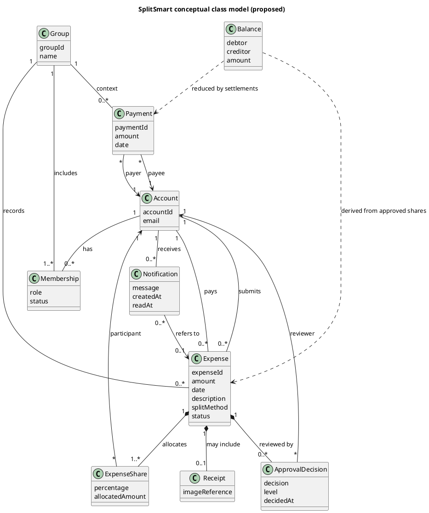
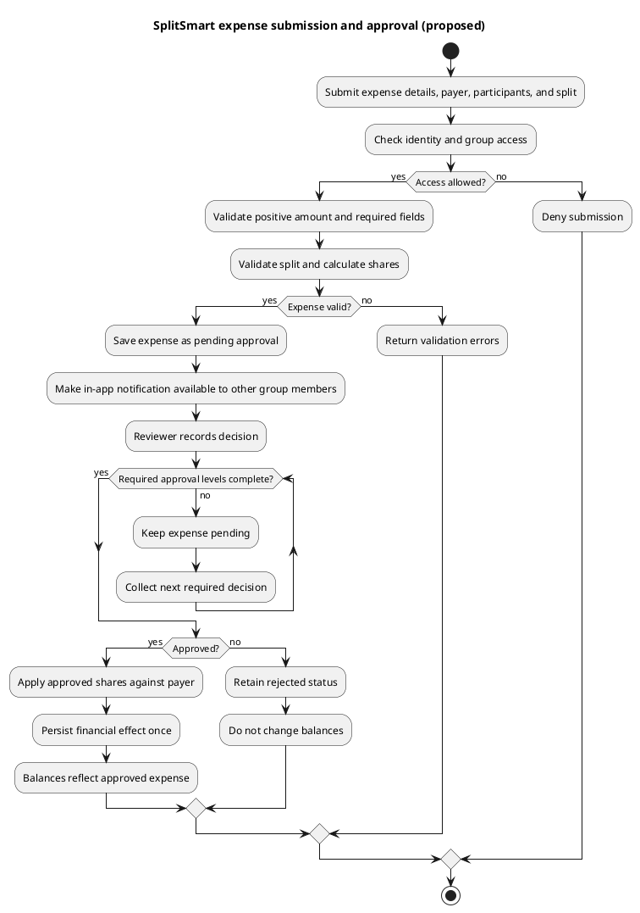

# SplitSmart Base Software Architecture

**Status**: Proposed logical design for CIS 285 Lab 7. Not an as-built architecture.  
**Source of requirements**: [spec.md](spec.md), `UserRequirement.md`, and `.specify/memory/constitution.md`.

## 1. Architecture Overview

SplitSmart is described as an expense-sharing product with accounts, groups, expenses, approvals, split allocation, notifications, bilateral balances, settlements, and reports. The customer requires web-first use plus Android and iOS clients. The constitution separately documents a Java 21/Maven/Swing desktop MVP direction. This architecture therefore presents clients and core responsibilities logically; it does not claim those components or platforms currently exist in code.

The architecture separates presentation from application coordination, domain rules, and infrastructure boundaries. Clients should not independently implement different money or approval rules. A future deployment decision must determine how each client reaches the application boundary and how common rules are shared.

## 2. Architectural Components

| Component | Responsibility | Requirement coverage | Status |
| --- | --- | --- | --- |
| Web client | Primary customer-facing experience for accounts, groups, expense workflows, payments, and reports. | FR-001–FR-009; FR-010 | Required by customer; implementation unverified |
| Android client | Mobile access to the core product workflows. | FR-001–FR-009; FR-010 | Required by customer; implementation unverified |
| iOS client | Mobile access to the core product workflows. | FR-001–FR-009; FR-010 | Required by customer; implementation unverified |
| Swing desktop client | Desktop presentation for the documented Java MVP direction. | Prototype subset | Documented direction; implementation unverified; does not fulfill FR-010 |
| Application boundary | Coordinates user use cases, identity/authorization checks, validation orchestration, and calls to domain and adapters. | FR-001–FR-009 | Proposed logical component |
| Account and group domain | Represents accounts, group membership, and manager rules. | FR-001, FR-002 | Proposed domain responsibility |
| Expense domain | Validates expense data, participants, payer, split method, shares, and lifecycle status. | FR-003, FR-004, FR-006 | Proposed domain responsibility |
| Approval workflow | Applies configured review levels and determines when an expense is approved and eligible for balance effects. | FR-006, FR-007 | Proposed domain responsibility; policy details open |
| Allocation and balance rules | Reconciles expense shares and computes amounts owed, net of payments. | FR-004, FR-007, FR-008 | Proposed domain responsibility |
| Payment domain | Retains payer/payee payment history and applies full or partial settlement amounts. | FR-008 | Proposed domain responsibility |
| Persistence adapter | Stores and retrieves domain records. The storage product is not selected. | FR-001–FR-009 | Proposed boundary |
| Notification adapter | Makes in-app notifications available to other group members at expense submission. | FR-005 | Proposed boundary |
| Reporting/query component | Builds authorized expense, balance, and payment summaries for requested ranges and parameters. | FR-009 | Proposed boundary |

## 3. Design Decisions

1. **Layer responsibilities.** User interfaces handle interaction and display; application use cases coordinate work; domain concepts enforce business rules; adapters handle persistence and notification delivery.
2. **Centralize financial rules.** Equal and percentage allocations, approval effects, and payment effects use the same domain rules across clients. For Java components, use `BigDecimal`; avoid binary floating point.
3. **Do not apply balances before approval.** Submission stores a pending expense. Only a completed approval workflow makes the expense eligible for balance calculation.
4. **Preserve financial history.** Approved expenses and payments are the basis for reconstructing or reconciling balances. Whether a balance is calculated on demand or kept as a projection is open; either choice must avoid duplicate application and reconcile to history.
5. **Isolate external choices.** Storage technology, API protocol, server framework, receipt storage, and notification infrastructure are not chosen because the repository provides no implementation evidence or deployment requirement.
6. **Preserve platform scope.** Swing is only the documented desktop MVP direction. It does not replace the required web, Android, or iOS product clients.
7. **Trace design artifacts.** Proposed components and entities map to FR-001–FR-011. They must be reconciled with real implementation evidence before being labeled implemented.

## 4. Data Flow

### 4.1 Expense Submission

1. A signed-in submitter selects a group, payer, participants, amount, date, description, split method, and optional receipt.
2. The client sends the submission through the application boundary. The boundary checks the caller and access to the group.
3. The expense domain validates positive amount, required participants and payer, split shares, and exact percentage total. It calculates candidate participant shares using the specified split rule and documented largest-remainder reconciliation, with currency scale/tie-break awaiting definition.
4. A valid expense is stored in `PENDING_APPROVAL` state. It has no balance effect.
5. The notification boundary makes an in-app notification available to every other group member, as documented. Failure/retry guarantees remain undecided.

### 4.2 Approval and Balance Application

1. An authorized reviewer submits an approval decision.
2. The workflow records the decision and checks whether the configured approval requirements are complete.
3. If approval remains pending or the expense is rejected, the balance remains unchanged.
4. When the required approval is complete, allocation and balance rules calculate each participant's share against the payer's advance. A payer who is also a participant does not owe themselves; a payer may be outside the participant set.
5. Approved status and financial effects are saved consistently. The implementation must ensure reprocessing does not apply the effect twice.

### 4.3 Payment and Reporting

1. A user records a payment between the relevant payer and payee accounts.
2. The payment record is retained. The payment policy validates amount and outstanding debt; overpayment and reversal handling are open decisions.
3. The balance view is recalculated from approved expense shares and payment history, or updated as a projection that can be reconciled against that history.
4. A report request supplies authorized scope and date range/parameters. Reporting reads expense, approval, payment, and balance information and returns a summary without changing financial state.

## 5. UML Class Diagram (PlantUML)

Conceptual classes only. Attribute types, persistence mapping, and framework relationships are intentionally omitted because no source code or storage decision exists.

`Balance` may be a computed view and need not be a stored entity. The class relationship between a payment and group is a contextual design association; the exact ownership rule should be finalized with group/payment policy.

## 6. UML Activity Diagram (PlantUML)

This activity diagram shows the documented expense lifecycle. It does not settle unresolved rejection, edit, resubmission, or self-approval policy.

## 7. Security and Quality Boundaries

- Authenticate users before exposing personal or group information; enforce authorization at the application boundary and scope data access to the authorized account/group.
- Validate financial and membership inputs at the domain/application boundary, not only in a client.
- Protect receipt access under the same authorization rules as the associated expense; format, size, retention, and encryption requirements remain unspecified.
- Keep monetary calculations exact in Java through `BigDecimal`; define currency scale and deterministic remainder ties before implementation acceptance.
- Test domain allocation, approval, and payment behavior independently of Swing with JUnit 5 for Java components. Add adapter integration tests when storage or notification choices are made.
- Do not state availability, performance, concurrency, backup, recovery, accessibility, or retention targets until agreed.

## 8. Proposed Versus Implemented

No application implementation was available in the inspected repository. All components, classes, interactions, and data flows in this document are proposals derived from the documented requirements. The project documents establish Java 21/Maven, Swing for a desktop MVP direction, `BigDecimal`, JUnit 5, and PlantUML as constraints; they do not establish that these technologies are present in a working application.
