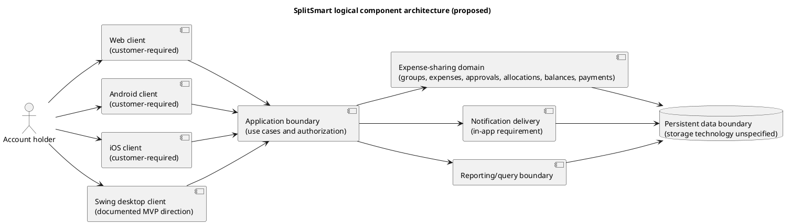
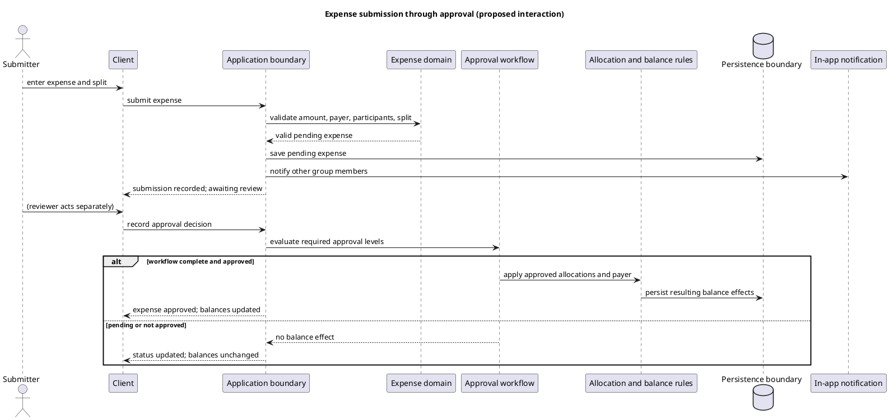

# SplitSmart Software Architecture and UML Design Specification

**Feature Branch**: `002-software-architecture`  
**Created**: 2026-11-05  
**Status**: Draft for CIS 285 Lab 7  
**Input**: User description: "Create a software architecture and design specification for my existing SplitSmart project for CIS 285 Lab 7. First inspect the repository to understand its actual features, programming language, frameworks, and structure. Document functional and nonfunctional requirements, user stories, and system requirements based on the existing application. Do not invent implemented features or modify application source code. This task is for architecture and UML design documentation."

## Repository Evidence and Scope

Repository inspection found these product documents: `UserRequirement.md`, `requirements.md`, and `specs/001-splitsmart/spec.md`, plus the project constitution at `.specify/memory/constitution.md`. No application source files, build manifests, executable, or test source files are present in the checked-in working tree. Therefore, the implemented language, framework, runtime structure, and actual application behavior cannot be established from source code in this repository.

The project documents specify Java 21 and Maven for Java components, Java Swing for a desktop MVP, object-oriented domain models, `BigDecimal` for money, JUnit 5, and PlantUML. These are documented engineering constraints and an intended prototype direction; this specification does not claim that they have been implemented. The customer requirement document describes the product capabilities. The existing spec records refinements such as one payer, invitation-only group membership, positive expense amounts, percentage shares totaling 100%, largest-remainder allocation, in-app notifications, and partial payments. These are treated as documented requirements, not as evidence of working features.

The architecture below is a logical design proposal for the documented expense-sharing product, suitable for the Lab 7 design deliverable. It is not an as-built diagram. No feature beyond the cited product documents is asserted as implemented.

## User Scenarios & Testing

### User Story 1 - Review the application architecture (Priority: P1)

As a student or reviewer, I need to understand the system's major responsibilities and their relationships so I can explain how the documented SplitSmart requirements fit into an architecture.

**Why this priority**: Architecture and UML design are the requested Lab 7 outcome.

**Independent Test**: A reviewer can follow the component and domain diagrams and trace each component to one or more documented requirements.

**Acceptance Scenarios**:

1. **Given** the architecture diagram, **When** a reviewer traces an account, expense, approval, balance, and payment workflow, **Then** the diagram shows client, application/domain, and data responsibilities without claiming they already exist in code.
2. **Given** the documented repository contents, **When** a reviewer checks architecture labels, **Then** each language or framework is marked as documented intent or unverified rather than represented as observed implementation.

### User Story 2 - Understand core expense-sharing behavior (Priority: P1)

As an account holder, I need to record and review shared expenses and see resulting balances so the group can understand who owes what.

**Why this priority**: Expense allocation and balance tracking are central to the customer requirements.

**Independent Test**: A reviewer can trace one submitted expense through approval to allocation and a bilateral balance update, including the case where approval is pending.

**Acceptance Scenarios**:

1. **Given** an expense with a payer, participants, and a valid split, **When** it is submitted, **Then** it awaits review and does not change balances before approval.
2. **Given** an expense that completes its required approval, **When** its allocations are applied, **Then** balances reflect the amounts owed and no user owes themselves.
3. **Given** a partial settlement payment, **When** it is recorded, **Then** only the recorded amount reduces the related outstanding balance and payment history retains the entry.

### User Story 3 - Review platform and engineering constraints (Priority: P2)

As a project reviewer, I need system requirements and known scope gaps recorded so I can distinguish the prototype direction from the complete customer product.

**Why this priority**: The written requirements explicitly include web, Android, and iOS, while the constitution describes Swing for a desktop MVP.

**Independent Test**: A reviewer can identify documented Java engineering constraints, the three required product platforms, and open quality targets without mistaking any for verified runtime behavior.

**Acceptance Scenarios**:

1. **Given** the system requirements, **When** a reviewer compares the Swing prototype direction with the customer platform requirement, **Then** the document records that Swing alone does not satisfy web, Android, and iOS availability.
2. **Given** the repository has no source or build manifest, **When** a reviewer asks which framework is actually used, **Then** the specification reports it as unverified.

## Functional Requirements

The following are requirements from the customer baseline and documented refinements. Their inclusion does not imply implementation status.

- **FR-001**: The system shall provide individual accounts and allow an account holder to log in and access their own expense and balance information. The documented project refinement specifies self-service email/password credentials.
- **FR-002**: Users shall be able to create and manage groups for shared expense and balance tracking. The documented refinement specifies invitation-only membership controlled by group managers.
- **FR-003**: A user shall be able to submit an expense with amount, date, description, and an optional receipt image. The documented refinement requires the amount to be greater than zero.
- **FR-004**: An expense shall identify involved users, one payer, and either an equal or percentage split. Percentage shares shall total exactly 100%; the payer may be outside the participant set. Allocations shall reconcile using the documented largest-remainder method, subject to the unresolved currency precision and tie-break policy.
- **FR-005**: The system shall notify every other group member in-app when an expense is submitted, as specified in the existing feature specification.
- **FR-006**: Submitted expenses shall be reviewed and approved according to a single- or multi-level group workflow before they affect balances.
- **FR-007**: The system shall track bilateral amounts owed between users from approved expenses and recorded settlement payments.
- **FR-008**: Users shall be able to record full or partial settlement payments, and payment history shall be retained.
- **FR-009**: Users shall be able to view expense, balance, and payment summaries and request reports by date range and other parameters.
- **FR-010**: The product shall be primarily web-based and also provide Android and iOS applications.
- **FR-011**: Product behavior represented in design artifacts shall be traceable to FR-001 through FR-010 or explicitly labeled as a design decision; diagrams shall not be described as implementation evidence.

### Functional Requirement Acceptance Checks

- **FR-001**: A signed-out account cannot access personal expense or balance information; a signed-in account can access its own information.
- **FR-002**: A user can create a group and group membership changes follow the documented invitation and manager rules.
- **FR-003**: A valid expense retains amount, date, and description with or without a receipt; zero and negative amounts are rejected.
- **FR-004**: Equal and percentage allocations identify each participant's share; invalid percentage totals are rejected and valid allocations reconcile to the total under the documented allocation rule.
- **FR-005**: On submission, every other group member can see an in-app notification for the expense.
- **FR-006**: Pending and rejected expenses have no balance effect; a fully approved expense proceeds to balance calculation.
- **FR-007**: Approved expense shares and their payer produce bilateral balances, with no self-owed balance.
- **FR-008**: A full or partial payment is retained in payment history and reduces the relevant outstanding balance by its recorded amount.
- **FR-009**: An account holder can inspect expense, balance, and payment summaries; a date-range request includes only matching records.
- **FR-010**: Product acceptance evidence identifies a primary web experience plus usable Android and iOS clients for core workflows.
- **FR-011**: Every architecture diagram element maps to a requirement or is labeled as a proposed design decision; no proposal is labeled as implemented without repository evidence.

## Nonfunctional Requirements

- **NFR-001 Monetary accuracy**: Monetary amounts, shares, payments, and balances shall be calculated without binary floating-point approximation. Java components shall use `BigDecimal`; allocation precision, currency scale, and deterministic tie-breaking require definition before implementation acceptance.
- **NFR-002 Access protection**: A person shall not access protected personal expense or balance information without authentication and applicable authorization. Group visibility and role rules must be defined before implementation acceptance.
- **NFR-003 Separation of concerns**: Presentation, business rules, and persistence responsibilities shall be separable. Domain calculations and approval/balance rules shall be verifiable independently of any GUI.
- **NFR-004 Maintainability and traceability**: Each designed behavior shall trace to a customer requirement or a clearly identified engineering decision. Deferred and unresolved requirements shall remain visible.
- **NFR-005 Cross-platform consistency**: Expense split, approval, balance, and payment rules shall have consistent outcomes across the required web, Android, and iOS product clients. The concrete mechanism for sharing or reproducing these rules remains an architecture decision.
- **NFR-006 Verification**: Java component tests shall use JUnit 5 per the constitution. Architecture and interaction diagrams shall be maintained in PlantUML where useful and reviewed for alignment with the requirements.
- **NFR-007 Privacy and data integrity**: Account, group, receipt, expense, and payment records shall be available only to authorized users, and accepted payments and approved expenses shall not be silently lost or applied twice. Retention, backup, recovery, audit, and availability targets have not been specified.

## User and System Requirements

### User Requirements

- Account holders need access to their own expenses and balances.
- Group managers and members need to organize shared activity and identify people involved in expenses.
- Expense submitters need to describe an expense, choose a split method, identify a payer, and optionally attach a receipt.
- Reviewers need to make approval decisions before expense amounts affect balances.
- Members need expense notifications; people who owe or are owed need balance and payment history.
- Report viewers need expense, balance, and payment summaries, including date-range and other filtering where supported.
- Users need a primary web experience and companion Android and iOS applications.

### System Requirements and Constraints

These are the requirements explicitly present in project documentation; they are not confirmed by an application build because no source/build configuration is present.

- Java components use Java 21 and Maven.
- The documented desktop MVP uses Java Swing; the customer product still requires web, Android, and iOS clients.
- Domain concepts should be cohesive object-oriented models, independent of GUI widgets.
- Java monetary calculations use `BigDecimal`, not binary floating-point types.
- Java automated tests use JUnit 5; PlantUML is the project's documented diagram format.
- The system needs persistent records for accounts, groups, membership, expenses, allocations, approval decisions, notifications, balances or their derivation, payments, and optional receipts. The storage product and deployment topology are not specified.
- The system requires a supported browser and network access for web use; supported browser versions and offline behavior are unspecified.
- Android and iOS minimum versions, distribution, and device requirements are unspecified.
- Performance, availability, concurrent-user capacity, accessibility, encryption details, retention, backup, and recovery targets remain to be set.

## Proposed Logical Architecture

This logical decomposition is a design proposal derived from documented responsibilities. Component placement and technology choices beyond the explicit Java constraints remain subject to implementation evidence and project decisions.



The diagram shows logical responsibilities only. It does not claim that these components, APIs, database, or integrations currently exist. A future deployment design must identify whether clients call a shared service or use another approved arrangement while preserving common business rules.

## UML Domain Model

The following conceptual model expresses entities implied by the documented requirements. It omits implementation-specific fields and does not assert that classes or tables exist in the repository.

```plantuml
@startuml
title SplitSmart conceptual domain model (proposed)
class Account { accountId; email }
class Group { groupId; name }
class Membership { role; status }
class Expense { expenseId; amount; date; description; status }
class ExpenseShare { amount or percentage }
class ApprovalDecision { decision; decidedAt }
class Receipt { image reference }
class Notification { message; createdAt; readAt }
class Payment { amount; date; note }
class Balance { amount; calculatedAt }

Account "1" -- "0..*" Membership
Group "1" -- "1..*" Membership
Group "1" -- "0..*" Expense
Account "1" -- "0..*" Expense : submits
Account "1" -- "0..*" Expense : pays
Expense "1" -- "1..*" ExpenseShare
ExpenseShare "*" -- "1" Account : participant
Expense "1" -- "0..*" ApprovalDecision
ApprovalDecision "*" -- "1" Account : reviewer
Expense "1" -- "0..1" Receipt
Account "1" -- "0..*" Notification : recipient
Expense "0..1" -- "0..*" Notification : about
Payment "*" -- "1" Account : payer
Payment "*" -- "1" Account : payee
Group "1" -- "0..*" Payment
Account "1" -- "0..*" Balance : debtor or creditor
@enduml
```

An implementation may derive balances from approved expenses and payments instead of persisting `Balance`; this model leaves that storage choice open. A payer can be separate from participants, matching the documented refinement. Group membership and authorization rules must govern visibility.

## UML Interaction: Expense Approval and Balance Update



This sequence is derived from FR-005 through FR-007. Notification timing follows the documented refinement that notification occurs at submission. Rejection, resubmission, self-approval, and concurrent approval policy remain open in the existing requirements.

## Key Entities

- **Account**: A person with credentials and personal expense/balance access.
- **Group**: A shared context for members, expenses, and settlements.
- **Membership**: Association between account and group, including the documented manager role.
- **Expense**: Submitted transaction with amount, date, description, payer, group, split method, status, and optional receipt.
- **ExpenseShare**: One participant's allocated amount or percentage for an expense.
- **ApprovalDecision**: A reviewer's decision in the configured expense workflow.
- **Receipt**: Optional image associated with an expense.
- **Notification**: In-app message for a group member about a submitted expense.
- **Payment**: Recorded transfer from one account to another that reduces an outstanding amount; partial payments are supported by the documented refinement.
- **Balance**: Amount currently owed between two accounts, either derived from expense/payment history or maintained as a consistent projection.

## Edge Cases

- An expense has a zero or negative amount, no participants, missing payer, or invalid split data.
- Percentage shares total below or above 100%, or multiple allocations have equal fractional remainders.
- The payer is not an expense participant, or is also a participant and must not owe themselves.
- An expense is pending, rejected, or only partly through a multi-level approval process; it must not affect balances before required approval completes.
- A duplicate approval event or payment submission could apply a financial effect twice; implementation must preserve single application of accepted records.
- A partial payment exceeds the remaining amount, is reversed, or refers to a disputed debt; handling is unspecified.
- A member is removed while expenses, receipts, or balances remain associated with the group; handling is unspecified.
- A notification recipient is no longer an active member when an expense is submitted; membership timing rules are unspecified.
- A requested report range crosses time zones or contains no records; boundary conventions are unspecified.
- Receipt data is missing, unreadable, oversized, or accessed by an unauthorized person; image limits and retention rules are unspecified.

## Assumptions and Open Questions

- The customer baseline is `UserRequirement.md`; the existing feature specification supplies refinements and implementation context, but does not prove the features are implemented.
- Logical architecture, UML, and entity descriptions are targets for design communication, not a reverse-engineered description of running software.
- Java 21, Maven, Swing, `BigDecimal`, JUnit 5, and PlantUML are treated as documented project constraints for the Java desktop MVP direction only.
- The repository contains no source/build files, so class names, package structure, persistence technology, APIs, deployment topology, and real client frameworks cannot be identified.
- Open questions inherited from `specs/001-splitsmart/spec.md` include account recovery and verification; group invitation and removal behavior; currency precision and remainder tie-break; expense correction; approval policy; payment correction/reversal and provider integration; receipt limits and retention; report filters, exports, and time zones; supported platform versions and parity; measurable quality targets; and full-product architecture.

## Success Criteria

- **SC-001**: This design specification traces all 10 customer feature areas to functional requirements.
- **SC-002**: A reviewer can identify the account, group, expense, approval, allocation, payment, notification, reporting, and balance responsibilities in the UML artifacts.
- **SC-003**: Every architecture element that cannot be verified in source is labeled as proposed, documented intent, or unspecified.
- **SC-004**: A reviewer can distinguish the documented Swing MVP direction from the required web, Android, and iOS product scope without treating one as satisfying the other.
- **SC-005**: Each documented business scenario has an acceptance path that identifies expected balance effects before and after approval or payment.

## Traceability

| Requirement area | Source | Design coverage |
| --- | --- | --- |
| FR-001 accounts | `UserRequirement.md`; `specs/001-splitsmart/spec.md` | Account entity; logical clients and application boundary |
| FR-002 groups | Same | Group and Membership entities |
| FR-003 expense details and receipt | Same | Expense and Receipt entities |
| FR-004 participants and split | Same | ExpenseShare and allocation responsibility |
| FR-005 notifications | Same | Notification responsibility and submission sequence |
| FR-006 approval | Same | ApprovalDecision, Approval workflow, sequence |
| FR-007 balances | Same | Balance and allocation responsibility |
| FR-008 payments | Same | Payment entity and balance effects |
| FR-009 reports | Same | Reporting/query boundary |
| FR-010 platforms | `UserRequirement.md`; constitution | Web, Android, iOS and documented Swing client distinctions |
